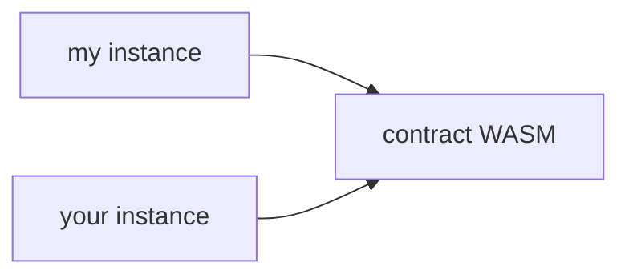

As you can imagine, if your deployed contract instance or the code that backs it is archived, it can't be loaded to execute your invocations. Remember, there's a distinct, one-to-many relationship on the chain between a contract's code and deployed instances of that contract:



We need **both** to be live for our contract calls to work.

Let's work through how these can be recovered. The recovery process is slightly different for a convenient reason: we don't need simulation to figure out the footprints. Instead, we can leverage [`Contract.getFootprint()`](https://stellar.github.io/js-stellar-sdk/reference/core-soroban-primitives/#contractgetfootprint) to get the ledger key of the contract instance. That key doesn't cover the backing WASM code, so we read the instance entry once to find its WASM hash and build the code's ledger key from it.

Unfortunately, we still need simulation to figure out the _fees_ for our restoration. This, however, can be easily covered by the SDK's [`Server.prepareTransaction()`](https://stellar.github.io/js-stellar-sdk/reference/network-rpc/#serverpreparetransactiontx-useupgradedauth) helper, which will do simulation and assembly for us.

<Info>

This guide makes use of the (aptly named) `submitTx` function we created in [another guide](../transactions/submit-transaction-wait-js).

</Info>

```typescript
import {
  Contract,
  Keypair,
  Networks,
  TransactionBuilder,
  SorobanDataBuilder,
  Operation,
  xdr,
} from "@stellar/stellar-sdk";
import { Server, Api } from "@stellar/stellar-sdk/rpc";

const server = new Server("https://soroban-testnet.stellar.org");

async function restoreContract(
  signer: Keypair,
  c: Contract,
): Promise<Api.GetTransactionResponse> {
  const instance = c.getFootprint();

  const account = await server.getAccount(signer.publicKey());
  const { entries } = await server.getLedgerEntries(instance);
  if (entries.length === 0) {
    throw new Error(`No instance entry found for ${c.contractId()}`);
  }
  const wasmEntry = getWasmLedgerKey(entries[0].val);

  // Bid what recent transactions paid, capped at what you're willing to spend.
  // prepareTransaction adds the resource fee on top of this inclusion fee.
  const { sorobanInclusionFee } = await server.getFeeStats();
  const MAX_FEE = 100_000; // stroops per operation (0.01 XLM): pick your own cap
  const fee = String(Math.min(Number(sorobanInclusionFee.p90), MAX_FEE));

  const restoreTx = new TransactionBuilder(account, { fee })
    .setNetworkPassphrase(Networks.TESTNET)
    .setSorobanData(
      // Set the restoration footprint (remember, it should be in the
      // read-write part!)
      new SorobanDataBuilder().setReadWrite([instance, wasmEntry]).build(),
    )
    .addOperation(Operation.restoreFootprint({}))
    .setTimeout(30)
    .build();

  const preppedTx = await server.prepareTransaction(restoreTx);
  preppedTx.sign(signer);
  return submitTx(preppedTx);
}

// Read the Wasm hash out of the contract instance entry
function getWasmLedgerKey(data: xdr.LedgerEntryData): xdr.LedgerKey {
  const { contractData } = xdr.expectUnionVariant(data, "contractData");
  const { instance } = xdr.expectUnionVariant(
    contractData.val,
    "scvContractInstance",
  );
  const { wasmHash } = xdr.expectUnionVariant(
    instance.executable,
    "contractExecutableWasm",
  );

  return xdr.LedgerKey.contractCode(
    new xdr.LedgerKeyContractCode({
      hash: wasmHash,
    }),
  );
}
```
