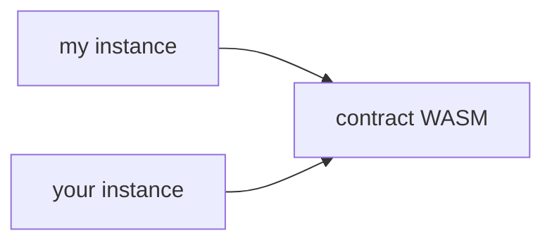

As you can imagine, if your deployed contract instance or the code that backs it is archived, it can't be loaded to execute your invocations. Remember, there's a distinct, one-to-many relationship on the chain between a contract's code and deployed instances of that contract:



We need **both** to be live for our contract calls to work.

Let's work through how these can be recovered. The recovery process is slightly different for a convenient reason: we don't need simulation to figure out the footprints. Instead, we can leverage [`Contract.getFootprint()`](https://stellar.github.io/js-stellar-sdk/reference/core-soroban-primitives/#contractgetfootprint) to get the ledger key of the contract instance (in Python and Go, we build the same key from the contract address). That key doesn't cover the backing WASM code, so we read the instance entry once to find its WASM hash and build the code's ledger key from it.

Unfortunately, we still need simulation to figure out the _fees_ for our restoration. This, however, can be easily covered by the SDK's [`Server.prepareTransaction()`](https://stellar.github.io/js-stellar-sdk/reference/network-rpc/#serverpreparetransactiontx-useupgradedauth) helper, which will do simulation and assembly for us. The Go SDK has no such helper, so the Go tab defines a small `prepareTransaction`.

<Info>

This guide makes use of the (aptly named) `submitTx` function (`submit_tx` in Python) we created in [another guide](/docs/build/guides/transactions/submit-transaction-wait).

</Info>

<CodeGroup>

```typescript JavaScript
import {
  Contract,
  Keypair,
  Networks,
  TransactionBuilder,
  SorobanDataBuilder,
  Operation,
  xdr,
} from "@stellar/stellar-sdk";
import { Server, Api } from "@stellar/stellar-sdk/rpc";

const server = new Server("https://soroban-testnet.stellar.org");

async function restoreContract(
  signer: Keypair,
  c: Contract,
): Promise<Api.GetTransactionResponse> {
  const instance = c.getFootprint();

  const account = await server.getAccount(signer.publicKey());
  const { entries } = await server.getLedgerEntries(instance);
  if (entries.length === 0) {
    throw new Error(`No instance entry found for ${c.contractId()}`);
  }
  const wasmEntry = getWasmLedgerKey(entries[0].val);

  // Bid what recent transactions paid, capped at what you're willing to spend.
  // prepareTransaction adds the resource fee on top of this inclusion fee.
  const { sorobanInclusionFee } = await server.getFeeStats();
  const MAX_FEE = 100_000; // stroops per operation (0.01 XLM): pick your own cap
  const fee = String(Math.min(Number(sorobanInclusionFee.p90), MAX_FEE));

  const restoreTx = new TransactionBuilder(account, { fee })
    .setNetworkPassphrase(Networks.TESTNET)
    .setSorobanData(
      // Set the restoration footprint (remember, it should be in the
      // read-write part!)
      new SorobanDataBuilder().setReadWrite([instance, wasmEntry]).build(),
    )
    .addOperation(Operation.restoreFootprint({}))
    .setTimeout(30)
    .build();

  const preppedTx = await server.prepareTransaction(restoreTx);
  preppedTx.sign(signer);
  return submitTx(preppedTx);
}

// Read the Wasm hash out of the contract instance entry
function getWasmLedgerKey(data: xdr.LedgerEntryData): xdr.LedgerKey {
  const { contractData } = xdr.expectUnionVariant(data, "contractData");
  const { instance } = xdr.expectUnionVariant(
    contractData.val,
    "scvContractInstance",
  );
  const { wasmHash } = xdr.expectUnionVariant(
    instance.executable,
    "contractExecutableWasm",
  );

  return xdr.LedgerKey.contractCode(
    new xdr.LedgerKeyContractCode({
      hash: wasmHash,
    }),
  );
}
```

```python Python
from stellar_sdk import (
    Address,
    Keypair,
    Network,
    SorobanDataBuilder,
    SorobanServer,
    TransactionBuilder,
    xdr,
)
from stellar_sdk.soroban_rpc import GetTransactionResponse

server = SorobanServer("https://soroban-testnet.stellar.org")


def restore_contract(signer: Keypair, contract_id: str) -> GetTransactionResponse:
    instance = get_instance_ledger_key(contract_id)

    account = server.load_account(signer.public_key)
    entries = server.get_ledger_entries([instance]).entries
    if not entries:
        raise ValueError(f"No instance entry found for {contract_id}")
    wasm_entry = get_wasm_ledger_key(entries[0].xdr)

    # Bid what recent transactions paid, capped at what you're willing to spend.
    # prepare_transaction adds the resource fee on top of this inclusion fee.
    MAX_FEE = 100_000  # stroops per operation (0.01 XLM): pick your own cap
    fee = min(server.get_fee_stats().soroban_inclusion_fee.p90, MAX_FEE)

    restore_tx = (
        TransactionBuilder(
            source_account=account,
            network_passphrase=Network.TESTNET_NETWORK_PASSPHRASE,
            base_fee=fee,
        )
        .set_soroban_data(
            # Set the restoration footprint (remember, it should be in the
            # read-write part!)
            SorobanDataBuilder().set_read_write([instance, wasm_entry]).build()
        )
        .append_restore_footprint_op()
        .set_timeout(30)
        .build()
    )

    prepped_tx = server.prepare_transaction(restore_tx)
    prepped_tx.sign(signer)
    return submit_tx(prepped_tx)


# The ledger key of the contract instance (what Contract.getFootprint()
# returns in JavaScript)
def get_instance_ledger_key(contract_id: str) -> xdr.LedgerKey:
    return xdr.LedgerKey(
        xdr.LedgerEntryType.CONTRACT_DATA,
        contract_data=xdr.LedgerKeyContractData(
            contract=Address(contract_id).to_xdr_sc_address(),
            key=xdr.SCVal(xdr.SCValType.SCV_LEDGER_KEY_CONTRACT_INSTANCE),
            durability=xdr.ContractDataDurability.PERSISTENT,
        ),
    )


# Read the Wasm hash out of the contract instance entry
def get_wasm_ledger_key(entry_xdr: str) -> xdr.LedgerKey:
    data = xdr.LedgerEntryData.from_xdr(entry_xdr)
    if data.contract_data is None:
        raise TypeError("Expected a contract data entry")
    instance = data.contract_data.val.instance
    if instance is None:
        raise TypeError("Expected a contract instance")
    executable = instance.executable
    if executable.type != xdr.ContractExecutableType.CONTRACT_EXECUTABLE_WASM:
        raise TypeError("Expected a Wasm executable")

    return xdr.LedgerKey(
        xdr.LedgerEntryType.CONTRACT_CODE,
        contract_code=xdr.LedgerKeyContractCode(hash=executable.wasm_hash),
    )
```

```go Go
// Add these imports to the ones from submitTx:
//
//   "github.com/stellar/go-stellar-sdk/keypair"
//   "github.com/stellar/go-stellar-sdk/network"
//   "github.com/stellar/go-stellar-sdk/strkey"
//   "github.com/stellar/go-stellar-sdk/xdr"
//
// assume that `server` is the client from submitTx

func restoreContract(
  ctx context.Context,
  signer *keypair.Full,
  contractID string,
) (protocol.GetTransactionResponse, error) {
  var none protocol.GetTransactionResponse
  instance, err := getInstanceLedgerKey(contractID)
  if err != nil {
    return none, err
  }

  account, err := server.LoadAccount(ctx, signer.Address())
  if err != nil {
    return none, err
  }
  instanceXDR, err := xdr.MarshalBase64(instance)
  if err != nil {
    return none, err
  }
  response, err := server.GetLedgerEntries(ctx, protocol.GetLedgerEntriesRequest{
    Keys: []string{instanceXDR},
  })
  if err != nil {
    return none, err
  }
  if len(response.Entries) == 0 {
    return none, fmt.Errorf("no instance entry found for %s", contractID)
  }
  wasmEntry, err := getWasmLedgerKey(response.Entries[0].DataXDR)
  if err != nil {
    return none, err
  }

  // Bid what recent transactions paid, capped at what you're willing to spend.
  // prepareTransaction adds the resource fee on top of this inclusion fee.
  feeStats, err := server.GetFeeStats(ctx)
  if err != nil {
    return none, err
  }
  const maxFee = 100_000 // stroops per operation (0.01 XLM): pick your own cap
  fee := min(int64(feeStats.SorobanInclusionFee.P90), maxFee)

  restoreOp := &txnbuild.RestoreFootprint{
    Ext: xdr.TransactionExt{
      V: 1,
      SorobanData: &xdr.SorobanTransactionData{
        Resources: xdr.SorobanResources{
          // Set the restoration footprint (remember, it should be in the
          // read-write part!)
          Footprint: xdr.LedgerFootprint{ReadWrite: []xdr.LedgerKey{instance, wasmEntry}},
        },
      },
    },
  }

  preppedTx, err := prepareTransaction(ctx, txnbuild.TransactionParams{
    SourceAccount:        account,
    IncrementSequenceNum: true,
    BaseFee:              fee,
    Preconditions:        txnbuild.Preconditions{TimeBounds: txnbuild.NewTimeout(30)},
    Operations:           []txnbuild.Operation{restoreOp},
  })
  if err != nil {
    return none, err
  }
  preppedTx, err = preppedTx.Sign(network.TestNetworkPassphrase, signer)
  if err != nil {
    return none, err
  }
  return submitTx(ctx, preppedTx.ToGenericTransaction())
}

// The ledger key of the contract instance (what Contract.getFootprint()
// returns in JavaScript)
func getInstanceLedgerKey(contractID string) (xdr.LedgerKey, error) {
  var key xdr.LedgerKey
  decoded, err := strkey.Decode(strkey.VersionByteContract, contractID)
  if err != nil {
    return key, err
  }
  var id xdr.ContractId
  copy(id[:], decoded)
  err = key.SetContractData(
    xdr.ScAddress{Type: xdr.ScAddressTypeScAddressTypeContract, ContractId: &id},
    xdr.ScVal{Type: xdr.ScValTypeScvLedgerKeyContractInstance},
    xdr.ContractDataDurabilityPersistent,
  )
  return key, err
}

// Read the Wasm hash out of the contract instance entry
func getWasmLedgerKey(entryXDR string) (xdr.LedgerKey, error) {
  var key xdr.LedgerKey
  var data xdr.LedgerEntryData
  if err := xdr.SafeUnmarshalBase64(entryXDR, &data); err != nil {
    return key, err
  }
  contractData, ok := data.GetContractData()
  if !ok {
    return key, errors.New("expected a contract data entry")
  }
  instance, ok := contractData.Val.GetInstance()
  if !ok {
    return key, errors.New("expected a contract instance")
  }
  wasmHash, ok := instance.Executable.GetWasmHash()
  if !ok {
    return key, errors.New("expected a Wasm executable")
  }

  err := key.SetContractCode(wasmHash)
  return key, err
}

// prepareTransaction simulates the transaction, then builds it again with the
// simulated resources and resource fee.
func prepareTransaction(ctx context.Context, params txnbuild.TransactionParams) (*txnbuild.Transaction, error) {
  tx, err := txnbuild.NewTransaction(params)
  if err != nil {
    return nil, err
  }
  envelope, err := tx.Base64()
  if err != nil {
    return nil, err
  }
  sim, err := server.SimulateTransaction(ctx, protocol.SimulateTransactionRequest{Transaction: envelope})
  if err != nil {
    return nil, err
  }
  if sim.Error != "" {
    return nil, fmt.Errorf("simulation failed: %s", sim.Error)
  }

  var sorobanData xdr.SorobanTransactionData
  if err := xdr.SafeUnmarshalBase64(sim.TransactionDataXDR, &sorobanData); err != nil {
    return nil, err
  }
  operation := params.Operations[0].(*txnbuild.RestoreFootprint)
  operation.Ext = xdr.TransactionExt{V: 1, SorobanData: &sorobanData}

  // Build again with the same sequence number.
  source := tx.SourceAccount()
  params.SourceAccount = &source
  params.IncrementSequenceNum = false
  return txnbuild.NewTransaction(params)
}
```

</CodeGroup>
