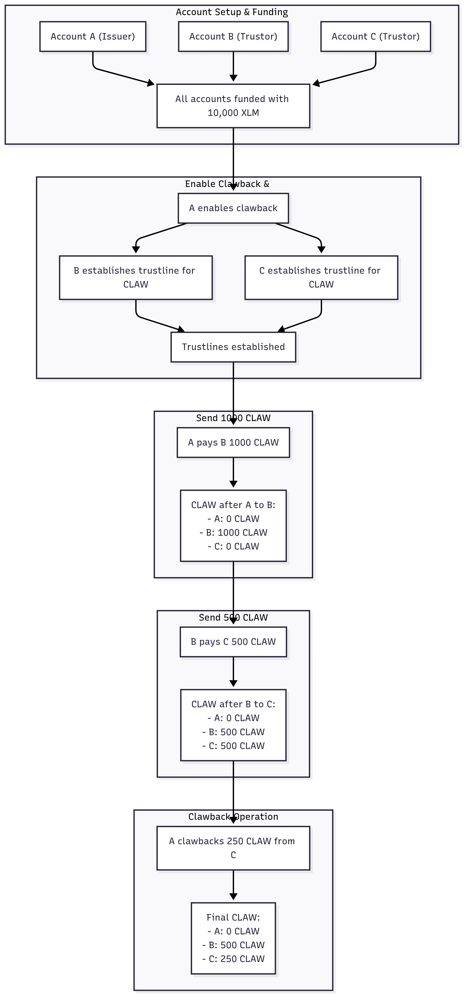

Clawbacks were introduced in [CAP-35: Asset Clawback](https://github.com/stellar/stellar-protocol/blob/master/core/cap-0035.md) and allow an asset issuer to burn a specific amount of a clawback-enabled asset from a trustline or claimable balance, effectively destroying it and removing it from a recipient's balance.

They were designed to allow asset issuers to meet securities regulations, which in many jurisdictions require asset issuers (or designated transfer agents) to have the ability to revoke assets in the event of a mistaken or fraudulent transaction or other regulatory action regarding a specific person or asset.

Clawbacks are useful for:

- Recovering assets that have been fraudulently obtained
- Responding to regulatory actions
- Enabling identity-proofed persons to recover an enabled asset in the event of loss of key custody or theft

## Operations

### Set Options

The issuer sets up their account to enable clawbacks using the `AUTH_CLAWBACK_ENABLED` flag. This causes every subsequent trustline established to any assets issued by that account to have the `TRUSTLINE_CLAWBACK_ENABLED_FLAG` set automatically.

If an issuing account wants to set the `AUTH_CLAWBACK_ENABLED_FLAG`, it must have the `AUTH_REVOCABLE_FLAG` set. This allows an asset issuer to claw back balances locked up in offers by first revoking authorization from a trustline, which pulls all offers that involve that trustline. The issuer can then perform the clawback.

### Clawback

The issuing account uses this operation to claw back some or all of an asset. Once an account holds a particular asset for which clawbacks have been enabled, the issuing account can claw it back, burning it. You need to provide the asset, a quantity, and the account from which you're clawing back the asset. For more details, refer the [Clawback operation](../../../learn/fundamentals/transactions/list-of-operations#clawback).

### Clawback Claimable Balance

This operation claws back a claimable balance, returning the asset to the issuer account, burning it. You must claw back the entire claimable balance, not just part of it. Once a claimable balance has been claimed, use the regular clawback operation to claw it back. Clawback claimable balances require the claimable balance ID. For more details, refer the [Clawback Claimable Balance operation](../../../learn/fundamentals/transactions/list-of-operations#clawback-claimable-balance).

### Set Trust Line Flag

The issuing account uses this operation to remove clawback capabilities on a specific trustline by removing the `TRUSTLINE_CLAWBACK_ENABLED_FLAG` via the [**SetTrustLineFlags**](../../../learn/fundamentals/transactions/list-of-operations#set-trustline-flags) operation.

You can only clear a flag, not set it. So clearing a clawback flag on a trustline is irreversible. This is done so that you don't retroactively change the rules on your asset holders. If you'd like to enable clawbacks again, holders must reissue their trustlines.

## Examples

Here we'll cover the following approaches to clawing back an asset.

**Example 1:** Issuing account (Account A) creates a clawback-enabled asset and sends it to Account B. Account B sends that asset to Account C. Account A will then clawback the asset from C. **Example 2:** Account B creates a claimable balance for Account C, and Account A claws back the claimable balance. **Example 3:** Account A issues a clawback-enabled asset to Account B. A claws back some of the asset from B, then removes the clawback enabled flag from the trustline and can no longer clawback the asset.

### Preamble: Creating + Funding Accounts and Issuing a Clawback-able Asset {#preamble-creating--funding-accounts-and-issuing-a-clawback-able-asset}

First, we'll set up an account to enable clawbacks and issue an asset accordingly.

Properly issuing an asset (with separate issuing and distribution accounts) is a little more involved, but we'll use a simpler method here.

Also, note that we first need to enable clawbacks and then establish trustlines since you cannot retroactively enable clawback on existing trustlines.

The following code snippet contains helper functions that will be used in the following examples.

<CodeGroup>

```js JavaScript
import * as sdk from "@stellar/stellar-sdk";

let server = new sdk.rpc.Server("https://soroban-testnet.stellar.org");

// Bid what recent transactions paid, capped at what you're willing to spend.
const { inclusionFee } = await server.getFeeStats();
const MAX_FEE = 100_000; // stroops per operation (0.01 XLM): pick your own cap
const fee = String(Math.min(Number(inclusionFee.p90), MAX_FEE));

const A = sdk.Keypair.random();
const B = sdk.Keypair.random();
const C = sdk.Keypair.random();

console.log("=== ACCOUNT SETUP ===");
console.log(`Account A (Issuer): ${A.publicKey()}`);
console.log(`Account B (Trustor): ${B.publicKey()}`);
console.log(`Account C (Trustor): ${C.publicKey()}`);
console.log();

const ASSET = new sdk.Asset("CLAW", A.publicKey());

// Helper function to format account ID with label
function formatAccount(accountId) {
  const shortId = accountId.substring(0, 8);
  if (accountId === A.publicKey()) {
    return `${shortId} (Account A)`;
  } else if (accountId === B.publicKey()) {
    return `${shortId} (Account B)`;
  } else if (accountId === C.publicKey()) {
    return `${shortId} (Account C)`;
  }
  return shortId;
}

// Helper function to safely scale XDR Int64 asset amounts
function scaleAsset(x) {
  return Number((x * 10n) / 10000000n) / 10; // one decimal place
}

// Helper function to fetch claimable balance details using SDK's built-in method
async function fetchClaimableBalance(
  balanceId,
  description = "Claimable Balance",
) {
  try {
    console.log(`\n--- Checking ${description} ---`);
    console.log(`Looking up balance ID: ${balanceId}`);

    // Use SDK's built-in getClaimableBalance method
    const claimableBalance = await server.getClaimableBalance(balanceId);
    const asset = sdk.Asset.fromOperation(claimableBalance.asset);
    const amount = scaleAsset(claimableBalance.amount).toFixed(1);

    console.log(`✅ Found claimable balance`);
    console.log(`   Amount: ${amount} ${asset.code}`);
    console.log(`   Number of claimants: ${claimableBalance.claimants.length}`);

    // Show claimant details
    claimableBalance.claimants.forEach((claimant, index) => {
      const destination = claimant.v0.destination.ed25519.toBytes();
      const claimantAddress = sdk.StrKey.encodeEd25519PublicKey(destination);
      console.log(
        `   Claimant ${index + 1}: ${formatAccount(claimantAddress)}`,
      );
    });

    return true; // Balance exists
  } catch (error) {
    console.log(`❌ Claimable balance not found (${error.message})`);
    return false; // Balance doesn't exist
  }
}

// Fund accounts first
function fundAccounts() {
  console.log("=== FUNDING ACCOUNTS WITH XLM ===");
  return Promise.all([
    server.requestAirdrop(A.publicKey()),
    server.requestAirdrop(B.publicKey()),
    server.requestAirdrop(C.publicKey()),
  ]).then(() => {
    console.log("All accounts funded with XLM via airdrop");
    // Wait for funding to complete
    return new Promise((resolve) => setTimeout(resolve, 3000));
  });
}

// Enables AuthClawbackEnabledFlag on an account.
function enableClawback(account, keys) {
  console.log(
    `Enabling clawback flags on account ${formatAccount(account.accountId())}`,
  );
  return submitAndPollTransaction(
    buildTx(account, keys, [
      sdk.Operation.setOptions({
        setFlags: sdk.AuthClawbackEnabledFlag | sdk.AuthRevocableFlag,
      }),
    ]),
    "Enable Clawback Flags",
  );
}

// Establishes a trustline for `recipient` for the CLAW Asset
const establishTrustline = function (recipient, key) {
  console.log(
    `${formatAccount(recipient.accountId())} establishing trustline for ${
      ASSET.code
    }`,
  );
  return submitAndPollTransaction(
    buildTx(recipient, key, [
      sdk.Operation.changeTrust({
        asset: ASSET,
        limit: "5000", // arbitrary
      }),
    ]),
    `Establish Trustline (${formatAccount(recipient.accountId())})`,
  );
};

// Retrieves latest account info for all accounts.
function getAccounts() {
  return Promise.all([
    server.getAccount(A.publicKey()),
    server.getAccount(B.publicKey()),
    server.getAccount(C.publicKey()),
  ]);
}

// Show XLM balances (after funding)
function showXLMBalances(accounts) {
  console.log("\n=== XLM BALANCES ===");
  return Promise.all(
    accounts.map((acc) => {
      return getXLMBalance(acc.accountId()).then((balance) => {
        console.log(`${formatAccount(acc.accountId())}: ${balance} XLM`);
      });
    }),
  );
}

// Get XLM balance using account ledger entry
function getXLMBalance(accountId) {
  return server
    .getAccountEntry(accountId)
    .then((accountEntry) => {
      return scaleAsset(accountEntry.balance).toFixed(1);
    })
    .catch(() => "0");
}

// Show CLAW balances
function showCLAWBalances(accounts) {
  console.log("\n=== CLAW BALANCES ===");
  return Promise.all(
    accounts.map((acc) => {
      return getBalance(acc.accountId()).then((balance) => {
        console.log(`${formatAccount(acc.accountId())}: ${balance} CLAW`);
      });
    }),
  );
}

// Get CLAW balance using getTrustline
function getBalance(accountId) {
  return server
    .getTrustline(accountId, ASSET)
    .then((trustlineEntry) => {
      return scaleAsset(trustlineEntry.balance).toFixed(1);
    })
    .catch(() => "0");
}

// Helps simplify creating & signing a transaction.
function buildTx(source, signer, ops) {
  var tx = new sdk.TransactionBuilder(source, {
    fee,
    networkPassphrase: sdk.Networks.TESTNET,
  });

  ops.forEach((op) => tx.addOperation(op));
  tx = tx.setTimeout(30).build();
  tx.sign(signer);
  return tx;
}

// Helper function to submit transaction and poll for completion using RPC
function submitAndPollTransaction(transaction, description = "Transaction") {
  return server.sendTransaction(transaction).then((submitResponse) => {
    if (submitResponse.status !== "PENDING") {
      throw new Error(
        `Transaction submission failed: ${submitResponse.status}`,
      );
    }

    console.log(`${description} submitted: ${submitResponse.hash}`);

    return server.pollTransaction(submitResponse.hash).then((finalResponse) => {
      if (finalResponse.status === "SUCCESS") {
        console.log(`${description} completed successfully`);
      } else {
        console.log(`${description} failed: ${finalResponse.status}`);
      }

      return {
        hash: submitResponse.hash,
        status: finalResponse.status,
        resultXdr: finalResponse.resultXdr,
      };
    });
  });
}

// Makes payment from `fromAccount` to `toAccount` of `amount`
function makePayment(toAccount, fromAccount, fromKey, amount) {
  console.log(
    `\nPayment: ${formatAccount(fromAccount.accountId())} → ${formatAccount(
      toAccount.accountId(),
    )} (${amount} CLAW)`,
  );
  return submitAndPollTransaction(
    buildTx(fromAccount, fromKey, [
      sdk.Operation.payment({
        destination: toAccount.accountId(),
        asset: ASSET,
        amount: amount,
      }),
    ]),
    `Payment of ${amount} CLAW`,
  );
}

// Creates a claimable balance from `fromAccount` to `toAccount` of `amount`
function createClaimable(fromAccount, fromKey, toAccount, amount) {
  console.log(
    `\nCreating claimable balance: ${formatAccount(
      fromAccount.accountId(),
    )} → ${formatAccount(toAccount.accountId())} (${amount} CLAW)`,
  );
  return submitAndPollTransaction(
    buildTx(fromAccount, fromKey, [
      sdk.Operation.createClaimableBalance({
        asset: ASSET,
        amount: amount,
        claimants: [new sdk.Claimant(toAccount.accountId())],
      }),
    ]),
    `Create Claimable Balance of ${amount} CLAW`,
  );
}

// Parse the ClaimableBalanceId from the transaction result XDR
function getBalanceId(txResponse) {
  const txResult = txResponse.resultXdr;
  const operationResult = txResult.result.results[0];

  let creationResult = operationResult.tr.createClaimableBalanceResult;
  return creationResult.balanceId.toXdr("hex");
}

// Clawback the claimable balance using its ID
function clawbackClaimable(issuerAccount, issuerKey, balanceId) {
  console.log(
    `\nClawback claimable balance: ${formatAccount(
      issuerAccount.accountId(),
    )} clawing back balance ${balanceId}`,
  );
  return submitAndPollTransaction(
    buildTx(issuerAccount, issuerKey, [
      sdk.Operation.clawbackClaimableBalance({ balanceId }),
    ]),
    `Clawback Claimable Balance`,
  );
}

// Clawback `amount` of CLAW from `fromAccount` by `byAccount`
function doClawback(byAccount, byKey, fromAccount, amount) {
  console.log(
    `\nClawback: ${formatAccount(
      byAccount.accountId(),
    )} clawing back ${amount} CLAW from ${formatAccount(
      fromAccount.accountId(),
    )}`,
  );
  return submitAndPollTransaction(
    buildTx(byAccount, byKey, [
      sdk.Operation.clawback({
        from: fromAccount.accountId(),
        asset: ASSET,
        amount: amount,
      }),
    ]),
    `Clawback of ${amount} CLAW`,
  );
}

// Disable clawback for a trustline by the issuer
function disableClawback(issuerAccount, issuerKeys, forTrustor) {
  console.log(
    `\nDisabling clawback for ${formatAccount(
      forTrustor.accountId(),
    )} on asset ${ASSET.code}`,
  );
  return submitAndPollTransaction(
    buildTx(issuerAccount, issuerKeys, [
      sdk.Operation.setTrustLineFlags({
        trustor: forTrustor.accountId(),
        asset: ASSET,
        flags: {
          clawbackEnabled: false,
        },
      }),
    ]),
    "Disable Clawback on Trustline",
  );
}

// Enables clawback on A, and establishes trustlines for the CLAW asset for accounts B and C.
function preamble() {
  console.log("\n=== SETTING UP CLAWBACK AND TRUSTLINES ===");
  return getAccounts().then(function (accounts) {
    let [accountA, accountB, accountC] = accounts;

    return enableClawback(accountA, A)
      .then(() => {
        console.log("Clawback enabled successfully");
        // Get fresh accounts after enabling clawback
        return getAccounts();
      })
      .then((refreshedAccounts) => {
        let [newAccountA, newAccountB, newAccountC] = refreshedAccounts;

        return Promise.all([
          establishTrustline(newAccountB, B),
          establishTrustline(newAccountC, C),
        ]);
      })
      .then(() => {
        console.log("All trustlines established successfully");
      });
  });
}
```

```python Python
import time

import requests
from stellar_sdk import (
    Asset,
    AuthorizationFlag,
    ChangeTrust,
    Claimant,
    Clawback,
    ClawbackClaimableBalance,
    CreateClaimableBalance,
    Keypair,
    Network,
    Payment,
    SetOptions,
    SetTrustLineFlags,
    SorobanServer,
    StrKey,
    TransactionBuilder,
    TrustLineFlags,
)
from stellar_sdk.soroban_rpc import GetTransactionStatus, SendTransactionStatus
from stellar_sdk.xdr import (
    ClaimableBalanceID,
    LedgerEntryData,
    LedgerEntryType,
    LedgerKey,
    LedgerKeyAccount,
    LedgerKeyClaimableBalance,
    LedgerKeyTrustLine,
    TransactionResult,
)

server = SorobanServer("https://soroban-testnet.stellar.org")

# Bid what recent transactions paid, capped at what you're willing to spend.
MAX_FEE = 100_000  # stroops per operation (0.01 XLM): pick your own cap
fee = min(server.get_fee_stats().inclusion_fee.p90, MAX_FEE)

A = Keypair.random()
B = Keypair.random()
C = Keypair.random()

print("=== ACCOUNT SETUP ===")
print(f"Account A (Issuer): {A.public_key}")
print(f"Account B (Trustor): {B.public_key}")
print(f"Account C (Trustor): {C.public_key}")
print()

ASSET = Asset("CLAW", A.public_key)


# Helper function to format account ID with label
def format_account(account_id):
    short_id = account_id[:8]
    if account_id == A.public_key:
        return f"{short_id} (Account A)"
    elif account_id == B.public_key:
        return f"{short_id} (Account B)"
    elif account_id == C.public_key:
        return f"{short_id} (Account C)"
    return short_id


# Helper function to scale int64 asset amounts
def scale_asset(x):
    return (x * 10 // 10_000_000) / 10  # one decimal place


# Helper function to read one ledger entry with getLedgerEntries
def get_ledger_entry(key):
    response = server.get_ledger_entries([key])
    if not response.entries:
        return None
    return LedgerEntryData.from_xdr(response.entries[0].xdr)


# Helper function to fetch claimable balance details
def fetch_claimable_balance(balance_id, description="Claimable Balance"):
    print(f"\n--- Checking {description} ---")
    print(f"Looking up balance ID: {balance_id}")

    key = LedgerKey(
        LedgerEntryType.CLAIMABLE_BALANCE,
        claimable_balance=LedgerKeyClaimableBalance(
            balance_id=ClaimableBalanceID.from_xdr_bytes(bytes.fromhex(balance_id))
        ),
    )
    entry = get_ledger_entry(key)
    if entry is None:
        print(
            f"❌ Claimable balance not found (Claimable balance {balance_id} not found)"
        )
        return False  # Balance doesn't exist

    claimable_balance = entry.claimable_balance
    asset = Asset.from_xdr_object(claimable_balance.asset)
    amount = scale_asset(claimable_balance.amount.int64)

    print("✅ Found claimable balance")
    print(f"   Amount: {amount:.1f} {asset.code}")
    print(f"   Number of claimants: {len(claimable_balance.claimants)}")

    # Show claimant details
    for index, claimant in enumerate(claimable_balance.claimants):
        destination = claimant.v0.destination.account_id.ed25519.uint256
        claimant_address = StrKey.encode_ed25519_public_key(destination)
        print(f"   Claimant {index + 1}: {format_account(claimant_address)}")

    return True  # Balance exists


# Fund accounts first
def fund_accounts():
    print("=== FUNDING ACCOUNTS WITH XLM ===")
    friendbot_url = server.get_network().friendbot_url
    for keypair in (A, B, C):
        response = requests.get(
            friendbot_url, params={"addr": keypair.public_key}, timeout=30
        )
        response.raise_for_status()
    print("All accounts funded with XLM via airdrop")
    # Wait for funding to complete
    time.sleep(3)


# Enables AUTHORIZATION_CLAWBACK_ENABLED on an account.
def enable_clawback(account, keys):
    label = format_account(account.account.account_id)
    print(f"Enabling clawback flags on account {label}")
    return submit_and_poll_transaction(
        build_tx(
            account,
            keys,
            [
                SetOptions(
                    set_flags=AuthorizationFlag.AUTHORIZATION_CLAWBACK_ENABLED
                    | AuthorizationFlag.AUTHORIZATION_REVOCABLE
                )
            ],
        ),
        "Enable Clawback Flags",
    )


# Establishes a trustline for `recipient` for the CLAW Asset
def establish_trustline(recipient, key):
    label = format_account(recipient.account.account_id)
    print(f"{label} establishing trustline for {ASSET.code}")
    return submit_and_poll_transaction(
        build_tx(recipient, key, [ChangeTrust(asset=ASSET, limit="5000")]),  # arbitrary
        f"Establish Trustline ({label})",
    )


# Retrieves latest account info for all accounts.
def get_accounts():
    return [server.load_account(kp.public_key) for kp in (A, B, C)]


# Show XLM balances (after funding)
def show_xlm_balances(accounts):
    print("\n=== XLM BALANCES ===")
    for acc in accounts:
        account_id = acc.account.account_id
        print(f"{format_account(account_id)}: {get_xlm_balance(account_id)} XLM")


# Get XLM balance using account ledger entry
def get_xlm_balance(account_id):
    key = LedgerKey(
        LedgerEntryType.ACCOUNT,
        account=LedgerKeyAccount(
            account_id=Keypair.from_public_key(account_id).xdr_account_id()
        ),
    )
    entry = get_ledger_entry(key)
    if entry is None:
        return "0"
    return f"{scale_asset(entry.account.balance.int64):.1f}"


# Show CLAW balances
def show_claw_balances(accounts):
    print("\n=== CLAW BALANCES ===")
    for acc in accounts:
        account_id = acc.account.account_id
        print(f"{format_account(account_id)}: {get_balance(account_id)} CLAW")


# Get CLAW balance using the trustline ledger entry
def get_balance(account_id):
    key = LedgerKey(
        LedgerEntryType.TRUSTLINE,
        trust_line=LedgerKeyTrustLine(
            account_id=Keypair.from_public_key(account_id).xdr_account_id(),
            asset=ASSET.to_trust_line_asset_xdr_object(),
        ),
    )
    entry = get_ledger_entry(key)
    if entry is None:
        return "0"
    return f"{scale_asset(entry.trust_line.balance.int64):.1f}"


# Helps simplify creating & signing a transaction.
def build_tx(source, signer, ops):
    builder = TransactionBuilder(
        source_account=source,
        network_passphrase=Network.TESTNET_NETWORK_PASSPHRASE,
        base_fee=fee,
    )
    for op in ops:
        builder.append_operation(op)
    tx = builder.set_timeout(30).build()
    tx.sign(signer)
    return tx


# Helper function to submit transaction and poll for completion using RPC
def submit_and_poll_transaction(transaction, description="Transaction"):
    submit_response = server.send_transaction(transaction)
    if submit_response.status != SendTransactionStatus.PENDING:
        raise RuntimeError(
            f"Transaction submission failed: {submit_response.status.value}"
        )

    print(f"{description} submitted: {submit_response.hash}")

    final_response = server.poll_transaction(submit_response.hash)
    if final_response.status == GetTransactionStatus.SUCCESS:
        print(f"{description} completed successfully")
    else:
        print(f"{description} failed: {final_response.status.value}")

    return {
        "hash": submit_response.hash,
        "status": final_response.status,
        "result_xdr": final_response.result_xdr,
    }


# Makes payment from `from_account` to `to_account` of `amount`
def make_payment(to_account, from_account, from_key, amount):
    from_id = from_account.account.account_id
    to_id = to_account.account.account_id
    print(
        f"\nPayment: {format_account(from_id)} → {format_account(to_id)} "
        f"({amount} CLAW)"
    )
    return submit_and_poll_transaction(
        build_tx(
            from_account,
            from_key,
            [Payment(destination=to_id, asset=ASSET, amount=amount)],
        ),
        f"Payment of {amount} CLAW",
    )


# Creates a claimable balance from `from_account` to `to_account` of `amount`
def create_claimable(from_account, from_key, to_account, amount):
    from_id = from_account.account.account_id
    to_id = to_account.account.account_id
    print(
        f"\nCreating claimable balance: {format_account(from_id)} → "
        f"{format_account(to_id)} ({amount} CLAW)"
    )
    return submit_and_poll_transaction(
        build_tx(
            from_account,
            from_key,
            [
                CreateClaimableBalance(
                    asset=ASSET, amount=amount, claimants=[Claimant(destination=to_id)]
                )
            ],
        ),
        f"Create Claimable Balance of {amount} CLAW",
    )


# Parse the ClaimableBalanceId from the transaction result XDR
def get_balance_id(tx_response):
    tx_result = TransactionResult.from_xdr(tx_response["result_xdr"])
    operation_result = tx_result.result.results[0]

    creation_result = operation_result.tr.create_claimable_balance_result
    return creation_result.balance_id.to_xdr_bytes().hex()


# Clawback the claimable balance using its ID
def clawback_claimable(issuer_account, issuer_key, balance_id):
    print(
        f"\nClawback claimable balance: "
        f"{format_account(issuer_account.account.account_id)} "
        f"clawing back balance {balance_id}"
    )
    return submit_and_poll_transaction(
        build_tx(
            issuer_account,
            issuer_key,
            [ClawbackClaimableBalance(balance_id=balance_id)],
        ),
        "Clawback Claimable Balance",
    )


# Clawback `amount` of CLAW from `from_account` by `by_account`
def do_clawback(by_account, by_key, from_account, amount):
    from_id = from_account.account.account_id
    print(
        f"\nClawback: {format_account(by_account.account.account_id)} "
        f"clawing back {amount} CLAW from {format_account(from_id)}"
    )
    return submit_and_poll_transaction(
        build_tx(
            by_account,
            by_key,
            [Clawback(asset=ASSET, from_=from_id, amount=amount)],
        ),
        f"Clawback of {amount} CLAW",
    )


# Disable clawback for a trustline by the issuer
def disable_clawback(issuer_account, issuer_keys, for_trustor):
    trustor_id = for_trustor.account.account_id
    print(
        f"\nDisabling clawback for {format_account(trustor_id)} "
        f"on asset {ASSET.code}"
    )
    return submit_and_poll_transaction(
        build_tx(
            issuer_account,
            issuer_keys,
            [
                SetTrustLineFlags(
                    trustor=trustor_id,
                    asset=ASSET,
                    clear_flags=TrustLineFlags.TRUSTLINE_CLAWBACK_ENABLED_FLAG,
                )
            ],
        ),
        "Disable Clawback on Trustline",
    )


# Enables clawback on A, and establishes trustlines for the CLAW asset for
# accounts B and C.
def preamble():
    print("\n=== SETTING UP CLAWBACK AND TRUSTLINES ===")
    account_a, account_b, account_c = get_accounts()

    enable_clawback(account_a, A)
    print("Clawback enabled successfully")

    # Get fresh accounts after enabling clawback
    account_a, account_b, account_c = get_accounts()
    establish_trustline(account_b, B)
    establish_trustline(account_c, C)
    print("All trustlines established successfully")
```

</CodeGroup>

### Example 1: Payments

This example will highlight how the asset issuer holds control over their asset regardless of how it gets distributed to the world.

In this scenario:

- Account A will pay Account B with 1000 tokens of its custom asset.
- Account B will then pay Account C 500 tokens in turn.
- Finally, Account A will claw back half of Account C's balance, burning 250 CLAW tokens.

<CodeGroup>

```js JavaScript
function examplePaymentAndThenClawback() {
  console.log("\n=== PAYMENT AND CLAWBACK EXAMPLE ===");
  return getAccounts()
    .then(function (accounts) {
      let [accountA, accountB, accountC] = accounts;

      // A issues 1000 CLAW to B
      return makePayment(accountB, accountA, A, "1000")
        .then(() => {
          console.log("\n--- After A → B payment ---");
          return getAccounts();
        })
        .then((refreshedAccounts) => {
          [accountA, accountB, accountC] = refreshedAccounts;
          return showCLAWBalances([accountA, accountB, accountC]);
        })
        .then(() => {
          // B sends 500 CLAW to C
          return makePayment(accountC, accountB, B, "500");
        })
        .then(() => {
          console.log("\n--- After B → C payment ---");
          return getAccounts();
        })
        .then((refreshedAccounts2) => {
          [accountA, accountB, accountC] = refreshedAccounts2;
          return showCLAWBalances([accountA, accountB, accountC]);
        })
        .then(() => {
          // A claws back 250 CLAW from C
          return doClawback(accountA, A, accountC, "250");
        });
    })
    .then(() => getAccounts());
}

// Run the example with proper promise chaining
function runExample1() {
  fundAccounts()
    .then(() => getAccounts())
    .then(showXLMBalances)
    .then(preamble)
    .then(examplePaymentAndThenClawback)
    .then((finalAccounts) => {
      console.log("\n--- FINAL BALANCES ---");
      return showCLAWBalances(finalAccounts);
    })
    .then(() => {
      console.log("\n=== CLAWBACK DEMO COMPLETED ===");
    })
    .catch((error) => {
      console.error("Error in example:", error.message);
    });
}
```

```python Python
def example_payment_and_then_clawback():
    print("\n=== PAYMENT AND CLAWBACK EXAMPLE ===")
    account_a, account_b, account_c = get_accounts()

    # A issues 1000 CLAW to B
    make_payment(account_b, account_a, A, "1000")
    print("\n--- After A → B payment ---")
    account_a, account_b, account_c = get_accounts()
    show_claw_balances([account_a, account_b, account_c])

    # B sends 500 CLAW to C
    make_payment(account_c, account_b, B, "500")
    print("\n--- After B → C payment ---")
    account_a, account_b, account_c = get_accounts()
    show_claw_balances([account_a, account_b, account_c])

    # A claws back 250 CLAW from C
    do_clawback(account_a, A, account_c, "250")
    return get_accounts()


def run_example1():
    try:
        fund_accounts()
        show_xlm_balances(get_accounts())
        preamble()
        final_accounts = example_payment_and_then_clawback()
        print("\n--- FINAL BALANCES ---")
        show_claw_balances(final_accounts)
        print("\n=== CLAWBACK DEMO COMPLETED ===")
    except Exception as error:
        print("Error in example:", error)
```

</CodeGroup>

When you invoke `runExample1()` (`run_example1()` in Python), you should see output similar to:

```text
=== ACCOUNT SETUP ===
Account A (Issuer): GDYIV7XB5M6OS4S2P3DAGIEKRXNKSYZ4LSS5VBWMFGNAO42WGBOQY2E5
Account B (Trustor): GA7JEMMG46H6CDXR757ZUZ6HCEXE64RKC4M4DYX5DME2XP2P3LXQFVIM
Account C (Trustor): GCLJYLVE43A73KV62YVC2H7ZK4CDSGMK7IYV2NC4WHQOFRQDFTBG6ZB7

=== FUNDING ACCOUNTS WITH XLM ===
All accounts funded with XLM via airdrop

=== XLM BALANCES ===
GDYIV7XB (Account A): 10000.0 XLM
GCLJYLVE (Account C): 10000.0 XLM
GA7JEMMG (Account B): 10000.0 XLM

=== SETTING UP CLAWBACK AND TRUSTLINES ===
Enabling clawback flags on account GDYIV7XB (Account A)
Enable Clawback Flags submitted: aa48d5bbf1e3c5b3b3ee6b21f4ab4dfbf52632e0d70b1f6e2a09ee33943093d5
Enable Clawback Flags completed successfully
Clawback enabled successfully
GA7JEMMG (Account B) establishing trustline for CLAW
GCLJYLVE (Account C) establishing trustline for CLAW
Establish Trustline (GCLJYLVE (Account C)) submitted: effb33b48f126ddd54237b8942d48fdfb562d7dc07500e9db07a1b223a5ef50e
Establish Trustline (GA7JEMMG (Account B)) submitted: e05fe02b4da8dff22285da2d927545288160ec8f68c1359cefbabdfd4f0020df
Establish Trustline (GA7JEMMG (Account B)) completed successfully
Establish Trustline (GCLJYLVE (Account C)) completed successfully
All trustlines established successfully

=== PAYMENT AND CLAWBACK EXAMPLE ===

Payment: GDYIV7XB (Account A) → GA7JEMMG (Account B) (1000 CLAW)
Payment of 1000 CLAW submitted: be5cfda0f1625762b3b3b704affa356ff04e5ab388b7b63ede1fa5ca9873c96a
Payment of 1000 CLAW completed successfully

--- After A → B payment ---

=== CLAW BALANCES ===
GDYIV7XB (Account A): 0 CLAW
GA7JEMMG (Account B): 1000.0 CLAW
GCLJYLVE (Account C): 0 CLAW

Payment: GA7JEMMG (Account B) → GCLJYLVE (Account C) (500 CLAW)
Payment of 500 CLAW submitted: 8a0d19c8e56487255ffe24f5453ffe78177acc6f39bad204bab2849415032555
Payment of 500 CLAW completed successfully

--- After B → C payment ---

=== CLAW BALANCES ===
GDYIV7XB (Account A): 0 CLAW
GA7JEMMG (Account B): 500.0 CLAW
GCLJYLVE (Account C): 500.0 CLAW

Clawback: GDYIV7XB (Account A) clawing back 250 CLAW from GCLJYLVE (Account C)
Clawback of 250 CLAW submitted: e63eed593a20fb5571e8189ff549cd1360849749c06294f00596fae30da0f23d
Clawback of 250 CLAW completed successfully

--- FINAL BALANCES ---

=== CLAW BALANCES ===
GCLJYLVE (Account C): 250.0 CLAW
GA7JEMMG (Account B): 500.0 CLAW
GDYIV7XB (Account A): 0 CLAW

=== CLAWBACK DEMO COMPLETED ===
```

<Accordion title="Clawback Flow Chart">



</Accordion>

Notice that Account A (the issuer) holds none of the asset despite clawing back 250 from Account C. This should drive home the fact that clawed-back assets are burned, not transferred.

It may be strange that A never holds any tokens of its custom asset, but that's exactly how issuing works: you create value where there used to be none. Sending an asset to its issuing account is equivalent to burning it, and auditing the total amount of an asset in existence is one of the benefits of properly distributing an asset via a distribution account, which we avoid doing here for example brevity.

### Example 2: Claimable Balances

Direct payments aren't the only way to transfer assets between accounts: claimable balances also do this. Since they are a separate payment mechanism, they need a separate clawback mechanism.

In this scenario:

- Account A will pay Account B with 1000 tokens of its custom asset.
- Account B creates a Claimable Balance for Account C for 300 tokens. (You can query the Claimable Balance via RPC's `getLedgerEntries` endpoint.)
- Account A then claws back the Claimable Balance from Account C.
- The Claimable Balance entry is deleted and no longer queryable.

<CodeGroup>

```js JavaScript
function exampleClaimableBalanceClawback() {
  console.log("\n=== CLAIMABLE BALANCE CLAWBACK EXAMPLE ===");
  let balanceId;

  return getAccounts()
    .then(function (accounts) {
      let [accountA, accountB, accountC] = accounts;

      console.log("\n--- Initial CLAW balances ---");
      return showCLAWBalances([accountA, accountB, accountC])
        .then(() => {
          // A pays 1000 CLAW to B
          return makePayment(accountB, accountA, A, "1000");
        })
        .then(() => {
          console.log("\n--- After A → B payment ---");
          return getAccounts();
        })
        .then((refreshedAccounts) => {
          [accountA, accountB, accountC] = refreshedAccounts;
          return showCLAWBalances([accountA, accountB, accountC]);
        })
        .then(() => {
          // B creates claimable balance for C
          return createClaimable(accountB, B, accountC, "300");
        })
        .then((txResp) => {
          balanceId = getBalanceId(txResp);
          console.log(`Claimable balance created with ID: ${balanceId}`);

          console.log("\n--- After claimable balance creation ---");
          return getAccounts()
            .then((refreshedAccounts2) => {
              [accountA, accountB, accountC] = refreshedAccounts2;
              return showCLAWBalances([accountA, accountB, accountC]);
            })
            .then(() => {
              // Check that the claimable balance exists
              return fetchClaimableBalance(
                balanceId,
                "claimable balance after creation",
              );
            })
            .then(() => {
              // A claws back the claimable balance
              return clawbackClaimable(accountA, A, balanceId);
            })
            .then(() => {
              // Check that the claimable balance no longer exists
              return fetchClaimableBalance(
                balanceId,
                "claimable balance after clawback",
              );
            });
        });
    })
    .then(() => getAccounts());
}

// Run the example with proper promise chaining
function runExample2() {
  fundAccounts()
    .then(() => getAccounts())
    .then(showXLMBalances)
    .then(preamble)
    .then(exampleClaimableBalanceClawback)
    .then((finalAccounts) => {
      console.log("\n--- FINAL BALANCES ---");
      return showCLAWBalances(finalAccounts);
    })
    .then(() => {
      console.log("\n=== CLAIMABLE BALANCE CLAWBACK DEMO COMPLETED ===");
    })
    .catch((error) => {
      console.error("Error in example:", error.message);
    });
}
```

```python Python
def example_claimable_balance_clawback():
    print("\n=== CLAIMABLE BALANCE CLAWBACK EXAMPLE ===")
    account_a, account_b, account_c = get_accounts()

    print("\n--- Initial CLAW balances ---")
    show_claw_balances([account_a, account_b, account_c])

    # A pays 1000 CLAW to B
    make_payment(account_b, account_a, A, "1000")
    print("\n--- After A → B payment ---")
    account_a, account_b, account_c = get_accounts()
    show_claw_balances([account_a, account_b, account_c])

    # B creates claimable balance for C
    tx_resp = create_claimable(account_b, B, account_c, "300")
    balance_id = get_balance_id(tx_resp)
    print(f"Claimable balance created with ID: {balance_id}")

    print("\n--- After claimable balance creation ---")
    account_a, account_b, account_c = get_accounts()
    show_claw_balances([account_a, account_b, account_c])

    # Check that the claimable balance exists
    fetch_claimable_balance(balance_id, "claimable balance after creation")

    # A claws back the claimable balance
    clawback_claimable(account_a, A, balance_id)

    # Check that the claimable balance no longer exists
    fetch_claimable_balance(balance_id, "claimable balance after clawback")
    return get_accounts()


def run_example2():
    try:
        fund_accounts()
        show_xlm_balances(get_accounts())
        preamble()
        final_accounts = example_claimable_balance_clawback()
        print("\n--- FINAL BALANCES ---")
        show_claw_balances(final_accounts)
        print("\n=== CLAIMABLE BALANCE CLAWBACK DEMO COMPLETED ===")
    except Exception as error:
        print("Error in example:", error)
```

</CodeGroup>

When you invoke `runExample2()` (`run_example2()` in Python), you should see output similar to:

```
=== ACCOUNT SETUP ===
Account A (Issuer): GBOK4XIKNCKVWKRG27EEMYX2H7H5GP6ZCLYJTORHJVV3ZDJZJXTUPKTJ
Account B (Trustor): GBI5XUOWLBL44DWJXURGQJX46TUSNEPQ553LZUGLFCVQ6KRRPEEFBPKE
Account C (Trustor): GANXLMMUIG7G5NT6GQZNE3OPCRCROYJLTR6PGRZHVURUGNURSF3H3ZEZ

=== FUNDING ACCOUNTS WITH XLM ===
All accounts funded with XLM via airdrop

=== XLM BALANCES ===
GBI5XUOW (Account B): 10000.0 XLM
GANXLMMU (Account C): 10000.0 XLM
GBOK4XIK (Account A): 10000.0 XLM

=== SETTING UP CLAWBACK AND TRUSTLINES ===
Enabling clawback flags on account GBOK4XIK (Account A)
Enable Clawback Flags submitted: 4812d2be7e8652dbeb29fd4d9387c71725e09e5f1d3500b3e913eebc9bec03b1
Enable Clawback Flags completed successfully
Clawback enabled successfully
GBI5XUOW (Account B) establishing trustline for CLAW
GANXLMMU (Account C) establishing trustline for CLAW
Establish Trustline (GANXLMMU (Account C)) submitted: eb2c17135109408d751cdbab9235c8a833922a66c6576fe76a7930a2ef9e7042
Establish Trustline (GBI5XUOW (Account B)) submitted: 1ebb5ed64cb1c5c9beb121d56c31b802fab885ef06b771b3d8617371482e115d
Establish Trustline (GANXLMMU (Account C)) completed successfully
Establish Trustline (GBI5XUOW (Account B)) completed successfully
All trustlines established successfully

=== CLAIMABLE BALANCE CLAWBACK EXAMPLE ===

--- Initial CLAW balances ---

=== CLAW BALANCES ===
GANXLMMU (Account C): 0 CLAW
GBI5XUOW (Account B): 0 CLAW
GBOK4XIK (Account A): 0 CLAW

Payment: GBOK4XIK (Account A) → GBI5XUOW (Account B) (1000 CLAW)
Payment of 1000 CLAW submitted: ec852daea2fea4e5b6a1d56530618f30642d9207767f30558d577b4f98e59850
Payment of 1000 CLAW completed successfully

--- After A → B payment ---

=== CLAW BALANCES ===
GANXLMMU (Account C): 0.0 CLAW
GBI5XUOW (Account B): 1000.0 CLAW
GBOK4XIK (Account A): 0 CLAW

Creating claimable balance: GBI5XUOW (Account B) → GANXLMMU (Account C) (300 CLAW)
Create Claimable Balance of 300 CLAW submitted: 743066775839ef5112fd2b8a26730700a986655c557abcb98b91c6fdbd12abde
Create Claimable Balance of 300 CLAW completed successfully
Claimable balance created with ID: 0000000091b5fe84a029c79d409ac88d34b7047a6cc9f95b2c2f965843db122ef70fac2c

--- After claimable balance creation ---

=== CLAW BALANCES ===
GBI5XUOW (Account B): 700.0 CLAW
GBOK4XIK (Account A): 0 CLAW
GANXLMMU (Account C): 0 CLAW

--- Checking claimable balance after creation ---
Looking up balance ID: 0000000091b5fe84a029c79d409ac88d34b7047a6cc9f95b2c2f965843db122ef70fac2c
✅ Found claimable balance
   Amount: 300.0 CLAW
   Number of claimants: 1
   Claimant 1: GANXLMMU (Account C)

Clawback claimable balance: GBOK4XIK (Account A) clawing back balance 0000000091b5fe84a029c79d409ac88d34b7047a6cc9f95b2c2f965843db122ef70fac2c
Clawback Claimable Balance submitted: a82a0ed067d34361da622a56a3b6d59a7c4a351414a69da4dc9df8a5728e7758
Clawback Claimable Balance completed successfully

--- Checking claimable balance after clawback ---
Looking up balance ID: 0000000091b5fe84a029c79d409ac88d34b7047a6cc9f95b2c2f965843db122ef70fac2c
❌ Claimable balance not found (Claimable balance 0000000091b5fe84a029c79d409ac88d34b7047a6cc9f95b2c2f965843db122ef70fac2c not found)

--- FINAL BALANCES ---

=== CLAW BALANCES ===
GBI5XUOW (Account B): 700.0 CLAW
GBOK4XIK (Account A): 0 CLAW
GANXLMMU (Account C): 0.0 CLAW

=== CLAIMABLE BALANCE CLAWBACK DEMO COMPLETED ===
```

### Example 3: Selectively Enabling Clawback

When you enable the `AUTH_CLAWBACK_ENABLED_FLAG` on your account, it will make all future trustlines have clawback enabled for any of your issued assets. This may not always be desirable as you may want certain assets to behave as they did before. Though you could work around this by reissuing assets from a “dedicated clawback” account, you can also simply disable clawbacks for certain trustlines by clearing the `TRUST_LINE_CLAWBACK_ENABLED_FLAG` on a trustline.

In this scenario:

- Account A issues an asset and sends 1000 tokens to a distribution account (Account B).
- Account A claws back 500 tokens from Account B.
- Account A then clears the trustline so that it (the issuer) can no longer clawback the asset.
- Account A then attempts to clawback 250 tokens from Account B and fails.

_Please note that Account C is not relevant in this example._

<CodeGroup>

```js JavaScript
function exampleSelectiveClawbackThenDisableClawback() {
  console.log("\n=== SELECTIVE CLAWBACK EXAMPLE ===");
  return getAccounts()
    .then((accounts) => {
      let [accountA, accountB] = accounts;

      console.log("\n--- Initial CLAW balances ---");
      return showCLAWBalances([accountA, accountB])
        .then(() => {
          // A pays 1000 CLAW to B
          return makePayment(accountB, accountA, A, "1000");
        })
        .then(() => {
          console.log("\n--- After A → B payment ---");
          return getAccounts();
        })
        .then((refreshedAccounts) => {
          [accountA, accountB] = refreshedAccounts;
          return showCLAWBalances([accountA, accountB]);
        })
        .then(() => {
          // A claws back 500 CLAW from B (should work)
          return doClawback(accountA, A, accountB, "500");
        })
        .then(() => {
          console.log("\n--- After first clawback ---");
          return getAccounts();
        })
        .then((refreshedAccounts2) => {
          [accountA, accountB] = refreshedAccounts2;
          return showCLAWBalances([accountA, accountB]);
        })
        .then(() => {
          // A disables clawback for B's trustline
          return disableClawback(accountA, A, accountB);
        })
        .then(() => {
          // Try to clawback again (should fail)
          return doClawback(accountA, A, accountB, "250");
        })
        .catch((err) => {
          console.log("Error:", err.message);
        });
    })
    .then(() => getAccounts());
}

// Run the example with proper promise chaining
function runExample3() {
  fundAccounts()
    .then(() => getAccounts())
    .then((accounts) => showXLMBalances([accounts[0], accounts[1]])) // Only show A and B
    .then(preamble) // This sets up clawback and trustlines for A, B, C
    .then(exampleSelectiveClawbackThenDisableClawback)
    .then((finalAccounts) => {
      console.log("\n--- FINAL BALANCES ---");
      return showCLAWBalances([finalAccounts[0], finalAccounts[1]]); // Only show A and B
    })
    .then(() => {
      console.log("\n=== SELECTIVE CLAWBACK DEMO COMPLETED ===");
    })
    .catch((error) => {
      console.error("Error in example:", error.message);
    });
}
```

```python Python
def example_selective_clawback_then_disable_clawback():
    print("\n=== SELECTIVE CLAWBACK EXAMPLE ===")
    account_a, account_b, _ = get_accounts()

    print("\n--- Initial CLAW balances ---")
    show_claw_balances([account_a, account_b])
    try:
        # A pays 1000 CLAW to B
        make_payment(account_b, account_a, A, "1000")
        print("\n--- After A → B payment ---")
        account_a, account_b, _ = get_accounts()
        show_claw_balances([account_a, account_b])

        # A claws back 500 CLAW from B (should work)
        do_clawback(account_a, A, account_b, "500")
        print("\n--- After first clawback ---")
        account_a, account_b, _ = get_accounts()
        show_claw_balances([account_a, account_b])

        # A disables clawback for B's trustline
        disable_clawback(account_a, A, account_b)

        # Try to clawback again (should fail)
        do_clawback(account_a, A, account_b, "250")
    except Exception as err:
        print("Error:", err)
    return get_accounts()


def run_example3():
    try:
        fund_accounts()
        accounts = get_accounts()
        show_xlm_balances([accounts[0], accounts[1]])  # Only show A and B
        preamble()  # This sets up clawback and trustlines for A, B, C
        final_accounts = example_selective_clawback_then_disable_clawback()
        print("\n--- FINAL BALANCES ---")
        show_claw_balances([final_accounts[0], final_accounts[1]])  # Only A and B
        print("\n=== SELECTIVE CLAWBACK DEMO COMPLETED ===")
    except Exception as error:
        print("Error in example:", error)
```

</CodeGroup>

When you invoke `runExample3()` (`run_example3()` in Python), you should see output similar to:

```text
=== ACCOUNT SETUP ===
Account A (Issuer): GCTYN2SAMM2SHM5LOCHS2P2I24MEHVYKHKCSO5XPR2H2GQCK6PFCQRK6
Account B (Trustor): GAWDYTIKQI7J3YSCSLWGAJPN6J62WQKDA3XCAC55DDRH5KCTEZ5IGGWP
Account C (Trustor): GC5KQ7H5G5E65OVZGKBVCXBJKTEHWBBLQ56L7DK4ATUHUH5VJP4YHQVC

=== FUNDING ACCOUNTS WITH XLM ===
All accounts funded with XLM via airdrop

=== XLM BALANCES ===
GCTYN2SA (Account A): 10000.0 XLM
GAWDYTIK (Account B): 10000.0 XLM

=== SETTING UP CLAWBACK AND TRUSTLINES ===
Enabling clawback flags on account GCTYN2SA (Account A)
Enable Clawback Flags submitted: 52e7e15d70e46dc3b551e787ec3be11692d2cc8e0b2fda070cebfa048c67cedd
Enable Clawback Flags completed successfully
Clawback enabled successfully
GAWDYTIK (Account B) establishing trustline for CLAW
GC5KQ7H5 (Account C) establishing trustline for CLAW
Establish Trustline (GAWDYTIK (Account B)) submitted: 3cf49bf597085ede004d566d151b9a917b31d1dbbfa81d71a64b615356702da7
Establish Trustline (GC5KQ7H5 (Account C)) submitted: 9250e62be27e3111924d36c0169f3b08e12565f8f842bf32a8a7a0efb098a080
Establish Trustline (GAWDYTIK (Account B)) completed successfully
Establish Trustline (GC5KQ7H5 (Account C)) completed successfully
All trustlines established successfully

=== SELECTIVE CLAWBACK EXAMPLE ===

--- Initial CLAW balances ---

=== CLAW BALANCES ===
GCTYN2SA (Account A): 0 CLAW
GAWDYTIK (Account B): 0 CLAW

Payment: GCTYN2SA (Account A) → GAWDYTIK (Account B) (1000 CLAW)
Payment of 1000 CLAW submitted: 9974f7a8f85dbe437a18364066959718ceeeaa3ae9a84ccd0e91da5f4e6bfaeb
Payment of 1000 CLAW completed successfully

--- After A → B payment ---

=== CLAW BALANCES ===
GAWDYTIK (Account B): 1000.0 CLAW
GCTYN2SA (Account A): 0 CLAW

Clawback: GCTYN2SA (Account A) clawing back 500 CLAW from GAWDYTIK (Account B)
Clawback of 500 CLAW submitted: b1729001fba89198f67bcff2de7fb47ea97c358e902688d88b76c6ff3947cec2
Clawback of 500 CLAW completed successfully

--- After first clawback ---

=== CLAW BALANCES ===
GAWDYTIK (Account B): 500.0 CLAW
GCTYN2SA (Account A): 0 CLAW

Disabling clawback for GAWDYTIK (Account B) on asset CLAW
Disable Clawback on Trustline submitted: a1fe18c12628806bac90936f563978d1f9a3333a1a77482d55d3b7af99e679a7
Disable Clawback on Trustline completed successfully

Clawback: GCTYN2SA (Account A) clawing back 250 CLAW from GAWDYTIK (Account B)
Clawback of 250 CLAW submitted: eab31d237832b513ca911cd2b4a4466a7b7b502f274dcc926b9910223fc2043f
Clawback of 250 CLAW failed: FAILED

--- FINAL BALANCES ---

=== CLAW BALANCES ===
GAWDYTIK (Account B): 500.0 CLAW
GCTYN2SA (Account A): 0 CLAW

=== SELECTIVE CLAWBACK DEMO COMPLETED ===
```
